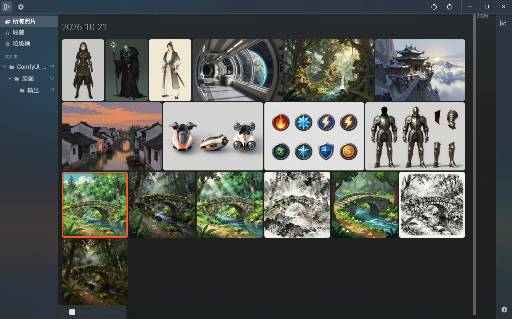
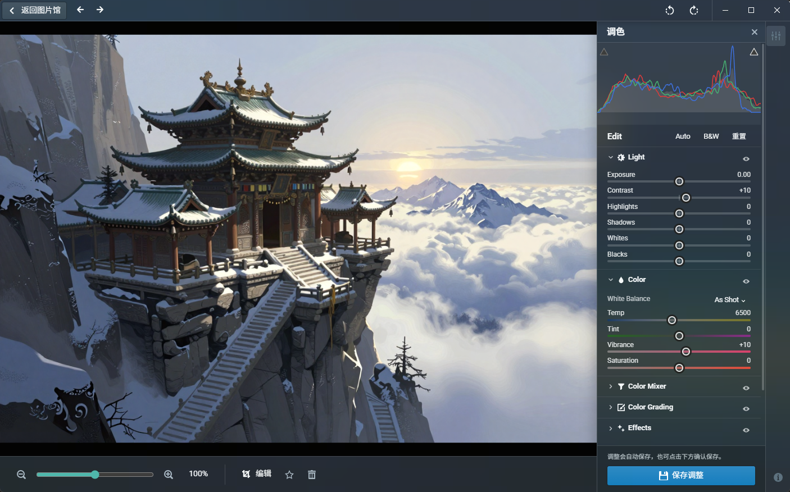

**English** | [简体中文](README.zh-CN.md)

# Picturama (Loy fork)

Digital image organizer powered by the web

> **Fork notice:** This is a fork of [picturama/picturama](https://github.com/picturama/picturama) —
> all credit for the original app goes to its authors, Til Schneider and Loïc Nogues. This repository
> extends the original with additional features and maintains its own releases.

## Download

Grab the latest Windows installer from the
[Releases](https://github.com/LoyWork/Loy_Picturama/releases) page of this repository.

## Screenshots

### Organize and browse your photo library

Browse photos in a thumbnail grid grouped by date, navigate folders in the sidebar,
and quickly access favorites or the trash.

### View and adjust your photos

View photos at full size and fine-tune exposure, contrast, highlights, shadows,
white balance, vibrance and saturation with a live RGB histogram. The adjustment
panel also includes Color Mixer, Color Grading and Effects sections.

## Features

Everything from the original Picturama:

- Scan local files - Keep your privacy, don't upload your personal photos to a cloud service
- Non-Destructive - The original images won't be touched (unless you purge the trash)
- Read various photo formats: JPG, PNG, WebP, HEIC / HEIF, TIF (macOS only)
- Read camera RAW through the vendored LightCraft engine: NEF/NRW, CR2/CR3, ARW, RAF, DNG, RW2, PEF, ORF and SRW, with embedded-preview fallback for unsupported variants. [Coverage and limitations](doc/raw-support.md).
- Browse photos by dates
- View photo in detail (zoomable)
- View EXIF information
- Tags
- Favorites
- Rotate photos
- Delete photos

Plus what this fork adds:

- Photo adjustments - Fine-tune light and color with an RGB histogram, plus Color Mixer,
  Color Grading and Effects controls
- Folder sidebar - Browse the top-level folders of your photo directories and filter the library by folder
- Unified filter sidebar - Photo views (all / favorites / trash), tags and folders in one place
- Photo context menu - Copy image to clipboard, delete from library, delete from disk (moves to the
  system trash) and open the containing folder, right from a photo

## Develop

See [DEVELOP.md](DEVELOP.md) for details about how to build Picturama.
